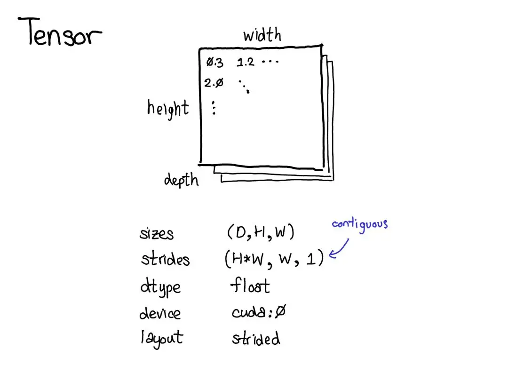

# PyTorch nâng cao: tổng quan kiến trúc

> Ghi chú của người biên soạn: trang này dịch từ ghi chú *pytorch架构概览* trong *dl_note* của **Harley Zhang** ([bản gốc](https://github.com/harleyszhang/dl_note/blob/main/2-deep_learning_basic/pytorch_code/pytorch架构概览.md), giấy phép [Apache-2.0](https://www.apache.org/licenses/LICENSE-2.0)), viết năm 2025 khi đọc mã nguồn PyTorch 2.7–2.8. Bản gốc minh hoạ bằng ảnh chụp màn hình máy tác giả (có đường dẫn thư mục cá nhân); ở đây thay bằng các khối code **soi trực tiếp bản PyTorch 2.14 đã cài** (bản dựng sẵn từ pip, CPU), chạy thật và in kết quả. Chỗ bản gốc sai ghi ở ô **Biên tập**.

## 1 Tổng quan về PyTorch

### 1.1 PyTorch là gì

Về bản chất, `PyTorch` là một thư viện tensor có vi phân tự động. Tensor là cấu trúc dữ liệu cốt lõi, hiểu theo hai góc độ:

1. Trực quan: một cấu trúc dữ liệu $n$ chiều chứa các phần tử cùng một kiểu vô hướng (số thực, số nguyên...).
2. Về cài đặt: một đối tượng (struct, class) gồm các trường dữ liệu như kích thước, kiểu phần tử (`dtype`), thiết bị (bộ nhớ CPU hay CUDA), bước nhảy (`stride`)...

<div align="center">

</div>

Hình 1: Một tensor $D\times H\times W$ và các trường mô tả nó: kích thước $(D, H, W)$, bước nhảy $(H\cdot W, W, 1)$ (liên tục), `dtype`, `device`, `layout`.

Huấn luyện mạng neuron cần hai thành phần chính:

- các kernel tính toán trên tensor;
- hệ thống vi phân tự động.

PyTorch trở thành framework huấn luyện phổ biến nhất chủ yếu nhờ **đồ thị động** và tính dễ dùng, dễ phát triển. Đồ thị động cho phép in kết quả tính toán ở bất kỳ bước nào: mỗi câu lệnh Python là một (hay vài) toán tử, **được gọi và thực hiện ngay khi chạy tới**. Cách thực thi từng toán tử này gọi là đồ thị động, hay chế độ eager.

> **Biên tập:** Bản gốc viết PyTorch là "framework huấn luyện chủ đạo duy nhất" và "mỗi câu lệnh chạy đồng bộ". JAX (Google) cũng là framework huấn luyện lớn, nhất là trên TPU. Và trên GPU, các toán tử CUDA được **xếp hàng bất đồng bộ** vào stream: câu lệnh Python trả về ngay khi kernel được đưa vào hàng đợi, chưa chắc GPU đã tính xong; chỉ khi đọc giá trị về CPU (`print`, `.item()`, `.cpu()`) hoặc gọi `torch.cuda.synchronize()` thì CPU mới chờ. Xem bài [c10: Stream và Event](tools/pt_c10_vi).

Luồng thực thi của PyTorch chia hai nửa: **frontend Python** và **backend C++**. Bản gốc minh hoạ bằng một sơ đồ tiếng Trung; tóm tắt lại như sau:

| Bước | Chế độ eager (đồ thị động) | Các cách lấy đồ thị (đồ thị tĩnh) |
| --- | --- | --- |
| Mã Python | `resnet50(x)` gọi `forward` | `torch.compile` (TorchDynamo bắt bytecode), `torch.fx` (dò vết toán tử), `torch.export`, TorchScript (`torch.jit.script`, `torch.jit.trace`, đã lỗi thời) |
| Gọi toán tử | `torch.conv2d(...)` trong Python | đồ thị trung gian: FX graph, TorchScript IR, HLO (qua torch-xla, LazyTensor) |
| C++ | dispatcher chọn kernel theo thiết bị, kiểu (`cpu`/`cuda` conv2d) | trình biên dịch tối ưu đồ thị (TorchInductor sinh kernel Triton/C++, XLA biên dịch HLO) |
| Thực thi | gọi API thiết bị (CUDA...) từng toán tử | chạy cả đồ thị đã biên dịch |

### 1.2 Frontend và backend

Frontend là giao diện Python của PyTorch: công cụ để dựng pipeline xử lý dữ liệu, định nghĩa mô hình, huấn luyện và đánh giá.

Backend là engine C++ bên dưới, thực hiện các phép tính mà frontend chỉ định: các kernel đại số tuyến tính và tích chập hiệu năng cao, trên nhiều thiết bị (CPU, CUDA, ROCm...), cùng engine autograd dựng đồ thị lan truyền ngược trong lúc chạy chiều xuôi.

Có thể thấy ranh giới đó ngay trong bản đã cài: phần Python là các tệp `.py` trong thư mục `torch/`, còn phần C++ nằm trong một mô-đun mở rộng (`torch._C`) và các thư viện động trong `torch/lib`:

<!-- run -->
```python
import os, torch
root = os.path.dirname(torch.__file__)
print("torch", torch.__version__, "| commit", torch.version.git_version[:10], "| CUDA:", torch.version.cuda)
print("torch/__init__.py :", "…/site-packages/" + torch.__file__.split("site-packages/")[-1])
print("mô-đun C++ _C     :", os.path.basename(torch._C.__file__))
libs = sorted(f for f in os.listdir(os.path.join(root, "lib")) if f.endswith(".so"))
for f in libs:
    if f.startswith(("libc10", "libtorch")):
        print(f"  lib/{f:<26} {os.path.getsize(os.path.join(root, 'lib', f)) / 2**20:8.1f} MB")
n_py = sum(f.endswith(".py") for _, _, fs in os.walk(root) for f in fs)
print("số tệp .py trong gói torch:", n_py)
```

<!-- output -->
```output
torch 2.14.0+cpu | commit 08187d9e0f | CUDA: None
torch/__init__.py : …/site-packages/torch/__init__.py
mô-đun C++ _C     : _C.cpython-311-x86_64-linux-gnu.so
  lib/libc10.so                       1.5 MB
  lib/libtorch.so                     0.0 MB
  lib/libtorch_cpu.so               417.9 MB
  lib/libtorch_global_deps.so         0.0 MB
  lib/libtorch_python.so             31.0 MB
  lib/libtorchbind_test.so            0.9 MB
số tệp .py trong gói torch: 2351
```
<!-- /output -->

`libtorch_cpu.so` chứa gần như toàn bộ kernel và autograd (bản có CUDA còn thêm `libtorch_cuda.so`), `libc10.so` là thư viện lõi c10, `libtorch_python.so` là lớp ràng buộc Python, còn `_C.cpython-...so` chỉ là "cửa vào" rất nhỏ (mục 3).

### 1.3 Biên dịch PyTorch từ mã nguồn (macOS)

1. Điều kiện: cài `CMake` (bản gốc khuyên cài bằng `brew` thay vì `conda`, và dùng phiên bản 3.31).

2. Với conda có sẵn, các bước biên dịch bản CPU:

```bash
# 1. Tạo môi trường ảo torch_dev với Python 3.12
conda create --name torch_dev python=3.12
conda activate torch_dev

# 2. Cài các gói phụ thuộc (chạy trong thư mục mã nguồn pytorch)
conda install cmake ninja
pip install -r requirements.txt
# nếu cần torch.distributed
conda install pkg-config libuv

# 3. Biên dịch và cài (rất lâu, cỡ một giờ trở lên)
MAX_JOBS=8 pip install -e . -v --no-build-isolation    # chế độ phát triển, 8 tiến trình biên dịch song song
# cách cũ, bản gốc dùng: MAX_JOBS=8 python setup.py develop
# hoặc cài thường (chép vào site-packages): pip install . -v --no-build-isolation
```

> **Biên tập:** Bản gốc dùng `python setup.py develop` và `python setpy.py install` (lỗi gõ). Gọi thẳng `python setup.py ...` đã bị setuptools đánh dấu lỗi thời; tài liệu biên dịch của PyTorch hiện hướng dẫn `pip install -e . -v --no-build-isolation` (tương đương `develop`). Các bước chi tiết của `setup.py` ở bài [Quá trình build](tools/pt_build_vi). Ảnh chụp kết quả biên dịch trên máy tác giả đã bỏ.

Khác với cài thường, chế độ phát triển (`develop`, hay `pip install -e`) **không chép tệp** vào môi trường Python, mà đặt thư mục mã nguồn vào đường dẫn tìm kiếm mô-đun: in `sys.path` trong Python sẽ thấy **có thêm thư mục mã nguồn pytorch**.

Nhờ vậy, khi sửa phần Python (ví dụ thêm một lớp `nn.Module` mới), **sửa xong là thấy hiệu quả ngay**, không phải biên dịch lại. Ví dụ, tác giả thêm `print("Get torch len is need to call self.shape[0]")` vào phương thức `__len__` của lớp `Tensor` trong `torch/_tensor.py`, rồi gọi `len(tensor)` thì dòng in hiện ra ngay. Phương thức đó trong bản đã cài:

<!-- run -->
```python
import inspect
src = inspect.getsource(torch.Tensor.__len__)
print(inspect.getsourcefile(torch.Tensor.__len__).split("site-packages/")[-1])
print(src)
```

<!-- output -->
```output
torch/_tensor.py
    def __len__(self):
        if has_torch_function_unary(self):
            return handle_torch_function(Tensor.__len__, (self,), self)
        if self.dim() == 0:
            raise TypeError("len() of a 0-d tensor")
        if torch._C._get_tracing_state():
            warnings.warn(
                "Using len to get tensor shape might cause the trace to be incorrect. "
                "Recommended usage would be tensor.shape[0]. "
                "Passing a tensor of different shape might lead to errors or silently give "
                "incorrect results.",
                category=torch.jit.TracerWarning,
                stacklevel=2,
            )
        return self.shape[0]
```
<!-- /output -->

## 2 Thư mục mã nguồn PyTorch

Phần này trùng gần như nguyên văn với bài [Cấu trúc mã nguồn](tools/pt_codebase_vi) của cùng tác giả; nội dung đầy đủ (cây thư mục, vai trò của `c10`, `aten`, `torch`, `tools`, các thư mục con của `c10`) ở bài đó.

### 2.3 Mô-đun _C

Trong PyTorch, mô-đun `_C` (thường viết `torch._C`) là giao diện của tầng C/C++ lõi: một thư viện động đã biên dịch (`.so` trên Linux, `.so`/`.dylib` trên macOS, `.pyd` trên Windows) đưa các cài đặt hiệu năng cao lên tầng Python.

Nguyên lý:

1. **Kernel C++/CUDA**: phần lớn phép tính, cấu trúc dữ liệu và thuật toán lõi cài đặt bằng C++, hỗ trợ nhiều thiết bị (CPU, GPU, XPU...).
2. **Cơ chế ràng buộc**: dùng `pybind11` (và ở các chỗ nóng như lớp `Tensor`, dùng thẳng C API của CPython) để đưa lớp và hàm C++ thành đối tượng Python.
3. **Biên dịch và đóng gói**: khi build, CMake và setuptools biên dịch mã C++ thành thư viện động và đặt vào gói Python (ví dụ `torch/_C.cpython-311-x86_64-linux-gnu.so`), để phân phối đa nền tảng.

> **Biên tập:** Bản gốc ghi đuôi tệp trên Windows là `.dll`; mô-đun mở rộng Python trên Windows có đuôi `.pyd`.

## 3 Hiểu tương tác frontend–backend qua torch.Tensor

### 3.1 Khởi tạo quan trọng khi `import torch`

Khi chạy `import torch`, Python tìm tệp `site-packages/torch/__init__.py`, điểm vào cao nhất của PyTorch. Tệp này **khởi tạo mô-đun, cấu hình toàn cục và nạp các mô-đun con**:

1. Khởi tạo mô-đun và cấu hình toàn cục: đọc thông tin phiên bản, cấu hình, khởi tạo log, biến môi trường.
2. Nạp thư viện động: nạp mô-đun `_C`, gọi hàm khởi tạo của nó (`PyInit__C()`) để khởi tạo các thành phần lõi tầng thấp.
3. Đóng gói API và dựng không gian tên.
4. Nạp các mô-đun con: `torch.nn`, `torch.optim`, `torch.cuda`... vào không gian tên.
5. Xử lý lỗi và tương thích: đảm bảo chạy được trên các hệ điều hành, môi trường CUDA/ROCm khác nhau, kèm cảnh báo khi cần.

Các thành phần liên quan tới tensor trong `__init__.py`:

1. Nạp lớp `Tensor`: `from torch._tensor import Tensor`. Lớp này kế thừa lớp C++ `torch._C.TensorBase`, là gốc của mọi phép toán trên tensor.
2. **Nạp thư viện động**: `_load_global_deps()` nạp các thư viện phụ thuộc, rồi `from torch._C import *` đưa mọi hàm C++ vào không gian tên `torch`.
3. **Số nguyên, số thực, bool ký hiệu** (`SymInt`, `SymFloat`, `SymBool`, `sym_int`...): dùng khi bắt đồ thị với kích thước động (`torch.compile(dynamic=True)`, `torch.export`).
4. Các hàm đặt thiết bị và kiểu mặc định:
   - `torch.set_default_device('cuda')`: tensor mới mặc định nằm trên GPU;
   - `torch.set_default_dtype(torch.float64)`: đổi kiểu số thực mặc định;
   - `set_default_tensor_type` là API cũ, nay khuyên dùng `set_default_dtype` kết hợp `set_default_device`.
5. **Lớp lưu trữ**: `TypedStorage` (đã lỗi thời) và `UntypedStorage` (dùng hiện nay).

<!-- run -->
```python
print("Tensor kế thừa:", [c.__module__ + "." + c.__name__ for c in torch.Tensor.__mro__])
print("_TensorBase là tên cũ của TensorBase:", torch._C._TensorBase is torch._C.TensorBase)
print("số tên lấy từ torch._C vào torch:", sum(1 for n in dir(torch._C) if hasattr(torch, n) and getattr(torch, n) is getattr(torch._C, n)))
print("torch.add là hàm C++:", type(torch.add).__name__, "| torch.nn.functional.relu là hàm Python:", type(torch.nn.functional.relu).__name__)
old = torch.get_default_dtype(); torch.set_default_dtype(torch.float64)
print("sau set_default_dtype(float64):", torch.tensor([1.0]).dtype); torch.set_default_dtype(old)
```

<!-- output -->
```output
Tensor kế thừa: ['torch.Tensor', 'torch._C.TensorBase', 'builtins.object']
_TensorBase là tên cũ của TensorBase: True
số tên lấy từ torch._C vào torch: 157
torch.add là hàm C++: builtin_function_or_method | torch.nn.functional.relu là hàm Python: function
sau set_default_dtype(float64): torch.float64
```
<!-- /output -->

### 3.2 Phân tích torch._C

Trên máy chạy trang này, `torch._C` là tệp `torch/_C.cpython-311-x86_64-linux-gnu.so` (trên máy macOS của tác giả là `_C.cpython-312-darwin.so`). Tên tệp ghi rõ phiên bản Python (`cpython-311`) và nền tảng (`x86_64-linux-gnu`), theo quy ước đặt tên mô-đun mở rộng C của Python (PEP 3149).

### 3.3 Khởi tạo và cài đặt lớp torch.Tensor

> Trong Python, kiểu cũng là đối tượng: mỗi kiểu là một đối tượng `PyTypeObject` ở tầng C.

`torch/_tensor.py` định nghĩa và bọc lớp tensor ở phía Python, nối cài đặt C++ với giao diện người dùng Python: `class Tensor(torch._C.TensorBase)` thêm các phương thức viết bằng Python (`__len__`, `__deepcopy__`, `__reduce_ex__`, `storage`...).

Khai báo của `TensorBase` nằm trong `torch/_C/__init__.pyi`. Đây là **tệp gợi ý kiểu** (stub) mô tả kiểu của các hàm, lớp, hằng số mà `torch._C` cài đặt bằng C++, nhưng không có cài đặt; một phần của nó được sinh tự động khi build. Trong tệp đó có dòng chú thích cho biết cài đặt thật của `TensorBase` nằm ở `torch/csrc/autograd/python_variable.cpp`:

<!-- run -->
```python
pyi = os.path.join(root, "_C", "__init__.pyi")
lines = open(pyi, encoding="utf-8").read().splitlines()
i = next(k for k, l in enumerate(lines) if l.startswith("class TensorBase("))
print("\n".join(lines[i - 1:i + 8]))
print("...")
attrs = [l.strip().split(":")[0] for l in lines[i + 1:i + 60] if ":" in l and not l.strip().startswith(("def", "@", "#"))]
print("một số thuộc tính khai báo:", attrs[:20])
```

<!-- output -->
```output
# Defined in torch/csrc/autograd/python_variable.cpp
class TensorBase(metaclass=_TensorMeta):
    requires_grad: _bool
    retains_grad: _bool
    shape: Size
    data: Tensor
    device: _device
    dtype: _dtype
    grad_dtype: _dtype | None
...
một số thuộc tính khai báo: ['requires_grad', 'retains_grad', 'shape', 'data', 'device', 'dtype', 'grad_dtype', 'layout', 'real', 'imag', 'T', 'H', 'mT', 'mH', 'ndim', 'output_nr', '_version', '_base', '_cdata', 'grad_fn']
```
<!-- /output -->

`THPVariable` ("Torch Python Variable") là struct C dùng để ràng buộc với Python, đại diện cho đối tượng `Tensor` ở tầng Python (trong lịch sử gọi là `Variable`). Lớp `Tensor` của Python kế thừa `TensorBase`, mà `TensorBase` được cài đặt bằng C++ và thêm vào mô-đun `_C` như sau:

```cpp
bool THPVariable_initModule(PyObject* module) {
  THPVariableMetaType.tp_base = &PyType_Type;
  if (PyType_Ready(&THPVariableMetaType) < 0)
    return false;
  Py_INCREF(&THPVariableMetaType);
  PyModule_AddObject(module, "_TensorMeta", (PyObject*)&THPVariableMetaType);

  static std::vector<PyMethodDef> methods;
  THPUtils_addPyMethodDefs(methods, torch::autograd::variable_methods);  // phương thức sinh tự động
  THPUtils_addPyMethodDefs(methods, extra_methods);
  THPVariableType.tp_methods = methods.data();
  if (PyType_Ready(&THPVariableType) < 0)          // hoàn tất kiểu Python
    return false;
  Py_INCREF(&THPVariableType);
  PyModule_AddObject(module, "TensorBase", (PyObject*)&THPVariableType);   // thêm vào torch._C
  Py_INCREF(&THPVariableType);
  PyModule_AddObject(module, "_TensorBase", (PyObject*)&THPVariableType);  // tên cũ, giữ để tương thích
  torch::autograd::initTorchFunctions(module);
  torch::autograd::initTensorImplConversion(module);
  torch::utils::validate_numpy_for_dlpack_deleter_bug();
  return true;
}
```

Trong `THPVariable_initModule`, các lệnh khởi tạo kiểu `THPVariableType` và tăng bộ đếm tham chiếu là cách chuẩn để thêm một kiểu vào mô-đun Python bằng C API: `PyModule_AddObject(module, "TensorBase", ...)` thêm đối tượng kiểu `THPVariableType` vào mô-đun `_C` (tham số `module`) dưới tên `TensorBase`.

> **Biên tập:** Bản gốc viết "trong `python_variable.cpp` có thể thấy PyTorch dùng pybind để tương tác C++ với Python". Đoạn code trên dùng thẳng **C API của CPython** (`PyType_Ready`, `PyModule_AddObject`, mảng `PyMethodDef`), không qua pybind11; PyTorch làm vậy cho lớp `Tensor` để giảm chi phí gọi ở đường nóng nhất. pybind11 được dùng cho phần lớn các API khác (ví dụ `torch._C._dispatch_*`, các lớp của `torch.distributed`).

Vì `Tensor` kế thừa `TensorBase`, phải khởi tạo `TensorBase` trước khi tạo được `Tensor`. Mà `TensorBase` thuộc mô-đun `_C`, nên khi `torch/__init__.py` chạy `from torch._C import *` thì `TensorBase` cũng đã được khởi tạo.

Khi Python chạy `import torch._C` (trực tiếp, hay gián tiếp qua `import torch`), trình thông dịch tự gọi `PyInit__C()` để khởi tạo mô-đun. `PyInit__C()` nằm trong `torch/csrc/stub.c`:

- **Quá trình build**: `stub.c` được biên dịch thành tệp đối tượng (`.o`), rồi liên kết với thư viện `libtorch_python` thành thư viện động cuối cùng, ví dụ `_C.cpython-311-x86_64-linux-gnu.so`.
- `stub.c` chỉ chứa một hàm, gọi sang `initModule()` cài đặt trong `torch/csrc/Module.cpp` (thuộc `libtorch_python`); đó là lý do tệp `_C...so` rất nhỏ.

```cpp
#include <Python.h>

extern PyObject* initModule(void);

#ifndef _WIN32
#ifdef __cplusplus
extern "C"
#endif
__attribute__((visibility("default"))) PyObject* PyInit__C(void);
#endif

PyMODINIT_FUNC PyInit__C(void)
{
  return initModule();
}
```

<!-- run -->
```python
import subprocess
so = torch._C.__file__
print(f"_C...so: {os.path.getsize(so) / 1024:.1f} KB")
deps = subprocess.run(["ldd", so], capture_output=True, text=True).stdout.splitlines()
print("phụ thuộc trực tiếp:", [d.split()[0] for d in deps if "torch" in d or "c10" in d])
syms = subprocess.run(["nm", "-D", "--defined-only", so], capture_output=True, text=True).stdout.split()
print("ký hiệu PyInit:", [s for s in syms if s.startswith("PyInit")])
```

<!-- output -->
```output
_C...so: 10.5 KB
phụ thuộc trực tiếp: ['libtorch_python.so', 'libtorch.so', 'libshm.so', 'libtorch_cpu.so', 'libc10.so', 'libgomp.so.1']
ký hiệu PyInit: ['PyInit__C']
```
<!-- /output -->

### 3.4 Quy ước khởi tạo mô-đun mở rộng của Python 3

Theo C API của Python 3, mỗi mô-đun mở rộng viết bằng C/C++ phải có một hàm khởi tạo tên bắt đầu bằng `PyInit_` và theo sau là tên mô-đun:

- mô-đun tên `_C` thì hàm khởi tạo phải tên `PyInit__C()`;
- hàm này được trình thông dịch tự gọi khi import, tạo và trả về một đối tượng mô-đun.

Ví dụ (đơn giản hoá) một hàm khởi tạo `PyInit__C`:

```cpp
static struct PyModuleDef moduledef = {
    PyModuleDef_HEAD_INIT,
    "_C",                        /* m_name */
    "Module for PyTorch core.",  /* m_doc */
    -1,                          /* m_size */
    NULL,                        /* m_methods */
};

PyMODINIT_FUNC PyInit__C(void) {
    PyObject *module = PyModule_Create(&moduledef);
    if (!module)
        return NULL;
    // gắn THPVariableType thành thuộc tính _TensorBase của mô-đun
    if (PyModule_AddObject(module, "_TensorBase", (PyObject *)&THPVariableType) < 0) {
        Py_DECREF(module);
        return NULL;
    }
    // ... các bước khởi tạo khác ...
    return module;
}
```

Hàm khởi tạo thực hiện mọi bước khởi tạo của mô-đun: đặt biến toàn cục, đăng ký hàm, tạo đối tượng kiểu... Chỉ khi nó trả về một đối tượng mô-đun hợp lệ, Python mới thêm mô-đun vào không gian tên để dùng.

> **Biên tập:** Bản gốc gọi tệp khởi tạo lúc là `stub.c`, lúc là `stub.cpp` (tên đúng là `torch/csrc/stub.c`), và câu cuối bị cắt dở ("hàm này được định nghĩa trong `stub.cpp`, và cái này..."). Ví dụ `PyModuleDef` ở trên là minh hoạ; trong PyTorch, `PyModule_Create` nằm trong `initModule()` của `Module.cpp`, còn `stub.c` chỉ chuyển tiếp.

## Tài liệu tham khảo

- [万字综述，核心开发者全面解读PyTorch内部张量机制](https://mp.weixin.qq.com/s/8J-vsOukt7xwWQFtwnSnWw) (bản dịch tiếng Trung của bài *PyTorch internals*, Edward Yang, [bản gốc tiếng Anh](http://blog.ezyang.com/2019/05/pytorch-internals/))
- [【Pytorch 源码 Detail 系列】Tensor“函数工厂” 上](https://zhuanlan.zhihu.com/p/346926464)
- [Let's talk about the PyTorch dispatcher](https://blog.ezyang.com/2020/09/lets-talk-about-the-pytorch-dispatcher/)
- [Building PyTorch from source](https://github.com/pytorch/pytorch#from-source)
