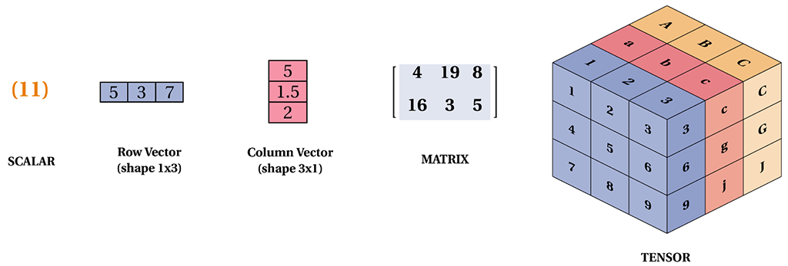

# PyTorch cơ bản: cấu trúc dữ liệu tensor

> Ghi chú của người biên soạn: trang này dịch từ ghi chú *Pytorch基础-tensor数据结构* trong *dl_note* của **Harley Zhang** ([bản gốc](https://github.com/harleyszhang/dl_note/blob/main/2-deep_learning_basic/pytorch_basic/Pytorch基础-tensor数据结构.md), [kho mã](https://github.com/harleyszhang/dl_note), giấy phép [Apache-2.0](https://www.apache.org/licenses/LICENSE-2.0)). Bản gốc viết cho PyTorch 1.7 (2021) dưới dạng phiên tương tác `>>>`; ở đây mọi đoạn code được chạy lại với **PyTorch 2.14** (CPU) và kết quả in ngay dưới code. Chỗ bản gốc sai hoặc đã lỗi thời được ghi ở ô **Biên tập**. Script `tensor_demo.py` trong thư mục `src` của bản gốc được dùng ở mục 2.4.

## Cách dùng trang này

Các khối chạy lần lượt từ trên xuống và dùng chung biến. Cần `torch` và `numpy`. Ví dụ nào trong bản gốc cần GPU (`device="cuda:0"`) thì ở đây chạy trên CPU và ghi chú lại.

## 1 Tổng quan về tensor

`torch.Tensor` là một mảng nhiều chiều chứa các phần tử **cùng một kiểu dữ liệu**, giống `array` của NumPy.



Hình 1: Vô hướng (0 chiều), vector hàng và vector cột (1 chiều), ma trận (2 chiều) và tensor nhiều chiều.

1. Tạo tensor với kiểu dữ liệu và thiết bị chỉ định bằng tham số `dtype` và/hoặc `device`. Muốn đổi `dtype` hay `device` của tensor đã có, dùng phương thức `to()`.

<!-- run -->
```python
import numpy as np
import torch
torch.manual_seed(0)
dev = "cuda:0" if torch.cuda.is_available() else "cpu"    # bản gốc dùng "cuda:0"; máy chạy trang này chỉ có CPU
print(torch.ones([2, 3], dtype=torch.float64, device=dev))
print(torch.ones([2, 3], dtype=torch.float32))
x = torch.ones(2, dtype=torch.int32)
print(x.to(torch.float16), x.to(dev, dtype=torch.float64))
```

<!-- output -->
```output
tensor([[1., 1., 1.],
        [1., 1., 1.]], dtype=torch.float64)
tensor([[1., 1., 1.],
        [1., 1., 1.]])
tensor([1., 1.], dtype=torch.float16) tensor([1., 1.], dtype=torch.float64)
```
<!-- /output -->

2. Đọc và sửa nội dung tensor bằng chỉ số hay cắt lát của Python, giống `ndarray`:

<!-- run -->
```python
matrix = torch.tensor([[2, 3, 4], [5, 6, 7]])
print(matrix[1][2], matrix[1, 2])          # matrix[1, 2] gọn và nhanh hơn matrix[1][2]
matrix[1][2] = 9
print(matrix)
```

<!-- output -->
```output
tensor(7) tensor(7)
tensor([[2, 3, 4],
        [5, 6, 9]])
```
<!-- /output -->

3. Lấy số Python từ **tensor chỉ có một giá trị** bằng `item()` hoặc `int()`, `float()`:

<!-- run -->
```python
x = torch.tensor([[4.5]])
print(x, x.item(), int(x), float(x))
```

<!-- output -->
```output
tensor([[4.5000]]) 4.5 4 4.5
```
<!-- /output -->

4. Tạo tensor với `requires_grad=True` để `torch.autograd` ghi lại các phép tính và tự lấy đạo hàm:

<!-- run -->
```python
x = torch.tensor([[1., -1.], [1., 1.]], requires_grad=True)
out = x.pow(2).sum()
out.backward()
print(x.grad)                               # d(Σx²)/dx = 2x
```

<!-- output -->
```output
tensor([[ 2., -2.],
        [ 2.,  2.]])
```
<!-- /output -->

5. Mỗi tensor có một vùng lưu trữ (storage) chứa dữ liệu; bản thân tensor là một **khung nhìn nhiều chiều có bước nhảy** (strided view) trên vùng đó: gồm kích thước (`shape`), bước nhảy (`stride`) và vị trí bắt đầu (`storage_offset`). Nhiều tensor có thể dùng chung một vùng lưu trữ:

<!-- run -->
```python
a = torch.arange(12).reshape(3, 4)
b = a.t()                                   # chuyển vị: không chép dữ liệu, chỉ đổi stride
c = a[1:, 2:]                               # cắt lát: cũng là khung nhìn
print("shape", tuple(a.shape), tuple(b.shape), tuple(c.shape))
print("stride", a.stride(), b.stride(), c.stride(), "| offset của c:", c.storage_offset())
print("dùng chung bộ nhớ:", a.untyped_storage().data_ptr() == b.untyped_storage().data_ptr() == c.untyped_storage().data_ptr())
c[0, 0] = 100
print(a)
```

<!-- output -->
```output
shape (3, 4) (4, 3) (2, 2)
stride (4, 1) (1, 4) (4, 1) | offset của c: 6
dùng chung bộ nhớ: True
tensor([[  0,   1,   2,   3],
        [  4,   5, 100,   7],
        [  8,   9,  10,  11]])
```
<!-- /output -->

> **Biên tập:** Bản gốc gọi vùng lưu trữ là `torch.Storage`. Từ PyTorch 2.0, các lớp storage có kiểu (`torch.FloatStorage`...) bị đánh dấu lỗi thời; truy cập vùng lưu trữ qua `tensor.untyped_storage()`. Cấu trúc bên trong (TensorImpl, StorageImpl) được phân tích ở bài [PyTorch nâng cao: cấu trúc tensor](tools/pt_tensorimpl_vi).

6. Tensor và mảng NumPy: `.numpy()` đổi tensor thành mảng NumPy, `torch.from_numpy()` đổi mảng thành tensor. Hai cách này **dùng chung bộ nhớ** giữa tensor và mảng; dùng `clone()` để chép và cắt liên kết:

<!-- run -->
```python
arr = np.random.rand(4, 5)
t = torch.from_numpy(arr)
arr1 = t.numpy()
print(type(arr), type(t), type(arr1))
arr[0, 0] = -1
print("sửa arr thì t đổi theo:", t[0, 0].item(), "| arr1 cũng đổi:", arr1[0, 0])
t2 = t.clone(); arr[0, 0] = -2
print("bản clone không đổi:", t2[0, 0].item())
```

<!-- output -->
```output
<class 'numpy.ndarray'> <class 'torch.Tensor'> <class 'numpy.ndarray'>
sửa arr thì t đổi theo: -1.0 | arr1 cũng đổi: -1.0
bản clone không đổi: -1.0
```
<!-- /output -->

7. `item()` và `tolist()` đổi tensor thành số và danh sách Python:

<!-- run -->
```python
scalar = torch.tensor(5)                    # vô hướng
s = scalar.item()
print(s, type(s))
t = torch.rand(3, 2).tolist()               # ma trận
print(t, type(t))
```

<!-- output -->
```output
5 <class 'int'>
[[0.49625658988952637, 0.7682217955589294], [0.08847743272781372, 0.13203048706054688], [0.30742281675338745, 0.6340786814689636]] <class 'list'>
```
<!-- /output -->

> **Biên tập:** Bản gốc in kết quả `1.0 <class 'float'>` cho `torch.tensor(5).item()`. `torch.tensor(5)` có kiểu `int64`, nên `item()` trả về số nguyên `5` (`int`), như kết quả chạy ở trên.

### 1.1 Kiểu dữ liệu của tensor

Bản gốc (2021) viết "Torch định nghĩa bảy kiểu tensor CPU và tám kiểu tensor GPU" kèm ảnh bảng `torch.FloatTensor`, `torch.cuda.FloatTensor`... Từ lâu PyTorch không còn tách kiểu theo thiết bị: kiểu dữ liệu là `dtype`, còn thiết bị là `device`, hai thuộc tính độc lập. Danh sách `dtype` hiện có:

<!-- run -->
```python
names = ["float64", "float32", "float16", "bfloat16", "float8_e4m3fn", "float8_e5m2",
         "complex64", "complex128", "int64", "int32", "int16", "int8", "uint8", "uint16", "uint32", "uint64", "bool"]
for n in names:
    dt = getattr(torch, n)
    info = torch.finfo(dt) if dt.is_floating_point else (torch.iinfo(dt) if not dt.is_complex and dt != torch.bool else None)
    rng = f"[{info.min:.3g}, {info.max:.3g}]" if info else ""
    print(f"torch.{n:<14} {torch.empty(0, dtype=dt).element_size()} byte  {rng}")
print("kiểu mặc định:", torch.get_default_dtype(), "| torch.Tensor(2, 3).dtype =", torch.Tensor(2, 3).dtype)
```

<!-- output -->
```output
torch.float64        8 byte  [-1.8e+308, 1.8e+308]
torch.float32        4 byte  [-3.4e+38, 3.4e+38]
torch.float16        2 byte  [-6.55e+04, 6.55e+04]
torch.bfloat16       2 byte  [-3.39e+38, 3.39e+38]
torch.float8_e4m3fn  1 byte  [-448, 448]
torch.float8_e5m2    1 byte  [-5.73e+04, 5.73e+04]
torch.complex64      8 byte  
torch.complex128     16 byte  
torch.int64          8 byte  [-9.22e+18, 9.22e+18]
torch.int32          4 byte  [-2.15e+09, 2.15e+09]
torch.int16          2 byte  [-3.28e+04, 3.28e+04]
torch.int8           1 byte  [-128, 127]
torch.uint8          1 byte  [0, 255]
torch.uint16         2 byte  [0, 6.55e+04]
torch.uint32         4 byte  [0, 4.29e+09]
torch.uint64         8 byte  [0, 1.84e+19]
torch.bool           1 byte  
kiểu mặc định: torch.float32 | torch.Tensor(2, 3).dtype = torch.float32
```
<!-- /output -->

`torch.Tensor` là tên viết tắt của kiểu tensor mặc định, tức số thực `32` bit (`torch.float32`). `bfloat16` (cùng số mũ với float32, ít bit phần định trị hơn) là kiểu chuẩn để huấn luyện mô hình lớn; các kiểu `float8` dùng cho lượng tử hoá và huấn luyện trên GPU mới (xem [bài lượng tử hoá](dlnote/compress_quant_vi)).

> **Biên tập:** Ảnh bảng kiểu dữ liệu của bản gốc (theo tài liệu PyTorch 1.x) được thay bằng danh sách in ra từ PyTorch 2.14 ở trên.

### 1.2 Thuộc tính của tensor

Tensor có nhiều thuộc tính, gồm kiểu dữ liệu, số chiều, kích thước.

+ **Kiểu dữ liệu**: đặt bằng tham số `dtype` của `torch.tensor()`.
+ **Số chiều**: dữ liệu khác nhau biểu diễn bằng tensor có số chiều (dimension) khác nhau. Vô hướng là tensor `0` chiều, vector `1` chiều, ma trận `2` chiều. Ảnh màu có ba kênh RGB, biểu diễn bằng tensor `3` chiều; video có thêm chiều thời gian, thành `4` chiều. Có bao nhiêu dấu `[` lồng nhau thì có bấy nhiêu chiều. **Lấy số chiều bằng phương thức `dim()`** (hay thuộc tính `ndim`).
+ **Kích thước**: xem độ dài mỗi chiều bằng thuộc tính `shape` hoặc phương thức `size()`; đổi kích thước bằng `view()` hoặc `reshape()`. Tensor bốn chiều trong PyTorch có dạng `(N, C, H, W)`.
+ **Tổng số phần tử**: `numel()`.
+ **Thiết bị**: `.device`.

> Cách hiểu kích thước tensor trong PyTorch, xem [câu trả lời này trên Stack Overflow](https://stackoverflow.com/questions/52370008/understanding-pytorch-tensor-shape).

<!-- run -->
```python
matrix = torch.tensor([[[1, 2, 3, 4], [5, 6, 7, 8]],
                       [[5, 4, 6, 7], [5, 6, 8, 9]]], dtype=torch.float64)
print(matrix)
print("dtype :", matrix.dtype)
print("dim   :", matrix.dim(), "| ndim:", matrix.ndim)
print("size():", matrix.size(), "| shape:", matrix.shape)
print("numel :", matrix.numel())
print("device:", matrix.device)
print("view(4, 2, 2):\n", matrix.view(4, 2, 2))
```

<!-- output -->
```output
tensor([[[1., 2., 3., 4.],
         [5., 6., 7., 8.]],

        [[5., 4., 6., 7.],
         [5., 6., 8., 9.]]], dtype=torch.float64)
dtype : torch.float64
dim   : 3 | ndim: 3
size(): torch.Size([2, 2, 4]) | shape: torch.Size([2, 2, 4])
numel : 16
device: cpu
view(4, 2, 2):
 tensor([[[1., 2.],
         [3., 4.]],

        [[5., 6.],
         [7., 8.]],

        [[5., 4.],
         [6., 7.]],

        [[5., 6.],
         [8., 9.]]], dtype=torch.float64)
```
<!-- /output -->

## 2 Tạo tensor

Có thể tạo tensor bằng cách truyền **dữ liệu** hoặc truyền **kích thước**. Hàm `torch.tensor()` chỉ nhận dữ liệu; hàm khởi tạo cũ `torch.Tensor()` nhận cả hai, rất dễ nhầm. Nên dùng `torch.tensor()` khi truyền dữ liệu, và `torch.empty()`, `torch.zeros()`... khi truyền kích thước.

<!-- run -->
```python
print(torch.tensor([2, 3]), torch.tensor([2, 3]).dtype)    # dữ liệu [2, 3], kiểu suy ra là int64
print(torch.Tensor([2, 3]), torch.Tensor([2, 3]).dtype)    # dữ liệu [2, 3] nhưng ép thành float32
print(torch.Tensor(2, 3).shape)                            # kích thước 2x3, giá trị rác chưa khởi tạo
```

<!-- output -->
```output
tensor([2, 3]) torch.int64
tensor([2., 3.]) torch.float32
torch.Size([2, 3])
```
<!-- /output -->

`torch.tensor()` thường dùng để đổi `list` của Python hay `ndarray` của NumPy thành tensor. **Kiểu dữ liệu được suy ra từ dữ liệu**: số nguyên thành `int64`, số thực Python thành `float32` (kiểu mặc định), mảng NumPy giữ nguyên kiểu (`float64` vẫn là `float64`).

> **Biên tập:** Bản gốc viết tensor tạo bằng `torch.tensor()` "có `dtype` mặc định là `torch.FloatTensor`", mâu thuẫn với chính ví dụ ngay dưới (mảng số nguyên cho `torch.int64`). Kiểu chỉ mặc định là float32 khi dữ liệu là số thực Python.

`torch.tensor()` luôn **chép** dữ liệu. Nếu đã có một tensor và chỉ muốn đổi `requires_grad`, dùng `requires_grad_()` hoặc `detach()` để khỏi chép. Nếu có mảng NumPy và muốn tránh chép, dùng `torch.as_tensor()` hoặc `torch.from_numpy()`.

### 2.1 Tạo bằng cách truyền dữ liệu

1. `torch.tensor()`: đổi `list` hoặc `ndarray` thành tensor.

```python
torch.tensor(data, dtype=None, device=None, requires_grad=False, pin_memory=False)
```

- `data`: dữ liệu, có thể là list, ndarray;
- `dtype`: kiểu dữ liệu, mặc định suy ra từ `data`;
- `device`: thiết bị, `cuda` hay `cpu`;
- `requires_grad`: có cần gradient không;
- `pin_memory`: có đặt trong bộ nhớ khoá trang (pinned memory) không, giúp chép sang GPU nhanh hơn.

<!-- run -->
```python
a = np.arange(12).reshape(3, 4)
b = torch.tensor(a)
print(b)
print(a.dtype, b.dtype, a.shape, b.shape, b.dim(), b.numel())
```

<!-- output -->
```output
tensor([[ 0,  1,  2,  3],
        [ 4,  5,  6,  7],
        [ 8,  9, 10, 11]])
int64 torch.int64 (3, 4) torch.Size([3, 4]) 2 12
```
<!-- /output -->

2. `torch.from_numpy(ndarray)`: tạo tensor từ mảng NumPy, **dùng chung bộ nhớ** với mảng (không chép dữ liệu, tiết kiệm bộ nhớ và thời gian); sửa một bên thì bên kia đổi theo.

<!-- run -->
```python
arr = np.arange(1, 7).reshape(2, 3)
ta = torch.from_numpy(arr)
ta[1][2] = 100
print(ta)
print(arr)
```

<!-- output -->
```output
tensor([[  1,   2,   3],
        [  4,   5, 100]])
[[  1   2   3]
 [  4   5 100]]
```
<!-- /output -->

3. `torch.empty_like`, `torch.zeros_like`, `torch.ones_like`, `torch.randint_like`: tạo tensor cùng kích thước (và mặc định cùng kiểu, cùng thiết bị) với tensor đầu vào; ba hàm đầu cho giá trị chưa khởi tạo, toàn 0, toàn 1; `randint_like` cho số nguyên ngẫu nhiên đều trong $[\text{low}, \text{high})$.

<!-- run -->
```python
a_tensor = torch.from_numpy(np.arange(20).reshape(5, 4))
b_like = torch.empty_like(a_tensor)
c_like = torch.zeros_like(a_tensor)
assert a_tensor.shape == b_like.shape == c_like.shape == torch.Size([5, 4])
print(c_like.shape, c_like.dtype)
print(torch.randint_like(a_tensor, low=0, high=10))
```

<!-- output -->
```output
torch.Size([5, 4]) torch.int64
tensor([[7, 3, 7, 3],
        [1, 6, 6, 9],
        [8, 6, 6, 8],
        [4, 3, 6, 9],
        [1, 4, 4, 1]])
```
<!-- /output -->

### 2.2 Tạo bằng cách truyền kích thước

`torch.empty`, `torch.zeros`, `torch.ones`... nhận thẳng kích thước:

```python
torch.zeros(*size, out=None, dtype=None, layout=torch.strided, device=None, requires_grad=False)
```

<!-- run -->
```python
print(torch.zeros(4, 5, 6).shape, torch.ones((2, 3)).dtype, torch.full([2, 2], 4), torch.eye(3))
```

<!-- output -->
```output
torch.Size([4, 5, 6]) torch.float32 tensor([[4, 4],
        [4, 4]]) tensor([[1., 0., 0.],
        [0., 1., 0.],
        [0., 0., 1.]])
```
<!-- /output -->

### 2.3 Các cách tạo khác

1. `torch.arange()`: như `np.arange()`, mặc định tạo tensor một chiều trên $[0, \text{end})$ với bước 1. `start` là giá trị đầu, `end` là giá trị cuối (không gồm), `step` là bước nhảy.
2. `torch.normal()`: lấy mẫu từ phân phối chuẩn với trung bình `mean` và độ lệch chuẩn `std` (số hoặc tensor); mỗi phần tử là một biến ngẫu nhiên độc lập. Với mẫu hữu hạn (ví dụ 3×3 = 9 phần tử), trung bình và độ lệch chuẩn của mẫu không đúng bằng của tổng thể, do **sai số lấy mẫu**; mẫu càng lớn, thống kê mẫu càng gần tham số tổng thể (mục 2.4).
3. `torch.randn()`, `torch.randn_like()`: phân phối chuẩn tắc (trung bình 0, phương sai 1).
4. `torch.randint(low=0, high, size)`: số nguyên ngẫu nhiên đều trong $[\text{low}, \text{high})$ với kích thước `size`. (`torch.randint_like(input, ...)` mới là bản lấy kích thước theo `input`.)
5. `torch.tril` và `torch.triu` (viết tắt của "triangle lower" và "triangle upper"): giữ phần tam giác dưới (gồm đường chéo chính và bên dưới) hoặc tam giác trên của ma trận, phần còn lại đặt bằng 0. Tham số `diagonal` dịch đường chéo được giữ: `diagonal=1` giữ thêm một đường chéo phía trên, `diagonal=-1` bỏ đường chéo chính. Mặt nạ nhân quả của Transformer chính là `torch.tril(torch.ones(n, n))`.

> **Biên tập:** Bản gốc mô tả `torch.randint` là "trả về tensor cùng kích thước với `input`" (đó là `randint_like`), gọi `torch.normal` là lấy mẫu từ "phân phối chuẩn rời rạc" (phân phối chuẩn là liên tục), và viết tiêu đề "`torch.tril` và `torch.tril`" (lỗi gõ của `triu`).

### 2.4 Ví dụ

<!-- run -->
```python
torch.manual_seed(0)
print(torch.arange(12).reshape(4, 3))
print(torch.normal(mean=0, std=2, size=[1, 4]))
print(torch.randn(2, 3).shape, torch.randint(10, (2, 5)))
print(torch.randn(4, 5).tril())
print(torch.ones(4, 5).triu(diagonal=1))
```

<!-- output -->
```output
tensor([[ 0,  1,  2],
        [ 3,  4,  5],
        [ 6,  7,  8],
        [ 9, 10, 11]])
tensor([[ 3.0820, -0.5869, -4.3576,  1.1369]])
torch.Size([2, 3]) tensor([[6, 9, 1, 4, 4],
        [1, 9, 9, 9, 0]])
tensor([[-0.1435,  0.0000,  0.0000,  0.0000,  0.0000],
        [ 0.1778, -0.2303,  0.0000,  0.0000,  0.0000],
        [ 0.2055, -0.4503,  1.5210,  0.0000,  0.0000],
        [-1.2341,  1.8197, -0.5515, -1.3253,  0.0000]])
tensor([[0., 1., 1., 1., 1.],
        [0., 0., 1., 1., 1.],
        [0., 0., 0., 1., 1.],
        [0., 0., 0., 0., 1.]])
```
<!-- /output -->

Kiểm tra trung bình và độ lệch chuẩn mẫu của `torch.normal` và `torch.randn` theo kích thước mẫu (hàm `generate_tensor_and_print_stats` trong `src/tensor_demo.py` của bản gốc):

<!-- run -->
```python
def generate_tensor_and_print_stats(size, func="normal", mean=0.0, std=1.0):
    """Sinh tensor và in trung bình, độ lệch chuẩn mẫu."""
    if func == "normal":
        tensor = torch.normal(mean=mean, std=std, size=size)
    elif func == "randn":
        tensor = torch.randn(size=size)
    else:
        raise ValueError(f"hàm không hợp lệ: {func}, chỉ nhận 'normal' hoặc 'randn'")
    print(f"Size {str(size):<12} torch.{func:<6}: mean {tensor.mean().item():+.4f}, std {tensor.std().item():.4f}")
    return tensor

torch.manual_seed(40)
for func in ["normal", "randn"]:
    for size in [(3, 3), (100, 100), (1000, 1000)]:
        generate_tensor_and_print_stats(size, func)
```

<!-- output -->
```output
Size (3, 3)       torch.normal: mean +0.4151, std 0.6608
Size (100, 100)   torch.normal: mean -0.0135, std 0.9947
Size (1000, 1000) torch.normal: mean +0.0002, std 1.0006
Size (3, 3)       torch.randn : mean -0.7619, std 1.1099
Size (100, 100)   torch.randn : mean -0.0133, std 1.0029
Size (1000, 1000) torch.randn : mean -0.0001, std 1.0001
```
<!-- /output -->

Với tensor $3\times3$, trung bình và độ lệch chuẩn mẫu lệch khá xa 0 và 1; với $100\times100$ lệch ít hơn; với $1000\times1000$, **trung bình rất gần 0, độ lệch chuẩn rất gần 1**. Sai số của trung bình mẫu giảm theo $1/\sqrt n$ (mục 5.4.3 bài [Nguyên lý cơ bản của học máy](dlnote/math_ml_vi)).

### Tổng kết các cách tạo tensor

| Hàm | Chức năng | Ghi chú |
| --- | --- | --- |
| `torch.rand(*sizes)` | phân phối **đều** trên $[0, 1)$ | |
| `torch.randn(*sizes)` | phân phối **chuẩn tắc** (trung bình 0, phương sai 1) | hay dùng để khởi tạo, sinh nhiễu |
| `torch.normal(mean, std, size)` | phân phối chuẩn với `mean`, `std` cho trước; `mean`, `std` có thể là tensor (mỗi phần tử một phân phối) | có nhiều dạng gọi |
| `torch.rand_like(a)` | như `rand`, kích thước theo `a` | |
| `torch.randint(low=0, high, size)` | số nguyên ngẫu nhiên đều trong $[\text{low}, \text{high})$ | hay dùng |
| `torch.full(size, value)` | mọi phần tử bằng `value` | |
| `torch.arange(start=0, end, step=1)` | dãy cách đều | hay dùng |
| `torch.linspace(start, end, steps)` | `steps` điểm cách đều, gồm cả hai đầu | |
| `torch.ones(*size)`, `zeros()`, `zeros_like()`, `eye()` | toàn 1, toàn 0, ma trận đơn vị | |

> **Biên tập:** Bảng gốc ghi `torch.rand` là "nên dùng" và `torch.randn` là "không nên dùng" mà không giải thích; hai hàm cho hai phân phối khác nhau, chọn theo nhu cầu, nên đã bỏ cột đánh giá đó.

## Tài liệu tham khảo

+ [PyTorch：view() 与 reshape() 区别详解](https://blog.csdn.net/Flag_ing/article/details/109129752)
+ [torch.rand和torch.randn和torch.normal和linespace()](https://zhuanlan.zhihu.com/p/115997577)
+ [Tài liệu `torch.Tensor`](https://pytorch.org/docs/stable/tensors.html) và [Tensor attributes](https://pytorch.org/docs/stable/tensor_attributes.html)
