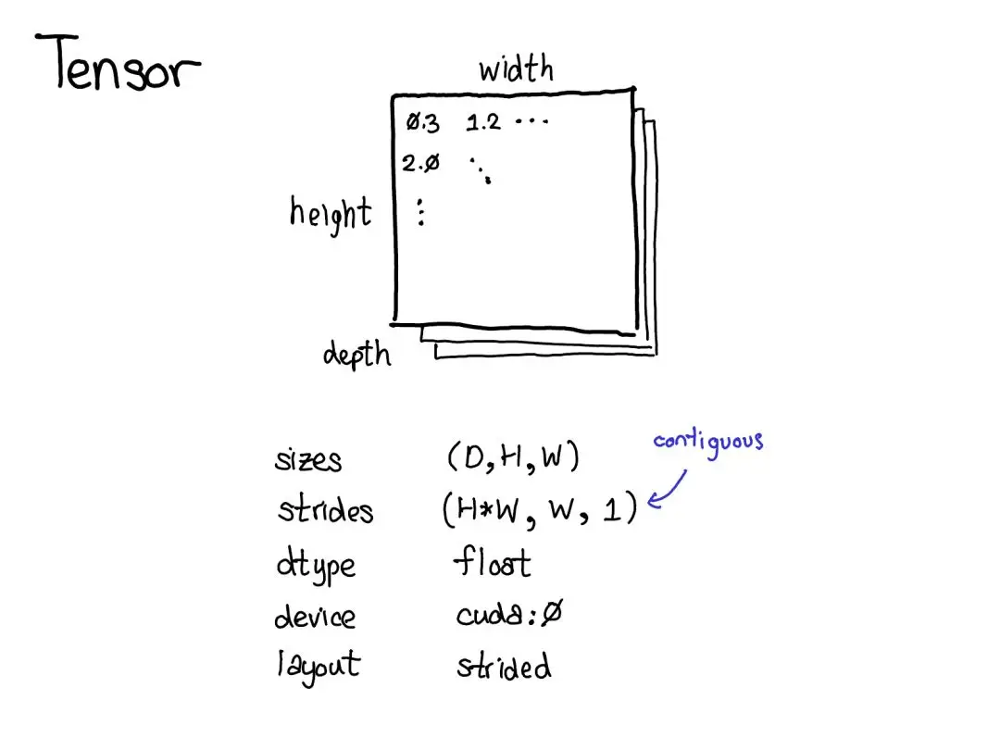

# PyTorch nâng cao: cài đặt tensor (TensorImpl)

> Ghi chú của người biên soạn: trang này dịch từ ghi chú *Pytorch 张量实现分析* trong *dl_note* của **Harley Zhang** ([bản gốc](https://github.com/harleyszhang/dl_note/blob/main/2-deep_learning_basic/pytorch_code/pytorch张量实现分析.md), giấy phép [Apache-2.0](https://www.apache.org/licenses/LICENSE-2.0)), viết tháng 3/2025 (bản gốc ghi "nội dung còn tiếp tục cập nhật"). Các khối code chạy với **PyTorch 2.14**. Danh sách trường của `TensorImpl` trong bản gốc đơn giản hoá quá mức ở vài chỗ; đã sửa theo mã nguồn `c10/core/TensorImpl.h` và ghi ở ô **Biên tập**. Mục 4 do người biên soạn viết thêm.

## 1 Các thuộc tính của torch.Tensor

Về bản chất, `PyTorch` là thư viện tensor có vi phân tự động; tensor (`torch.Tensor`) là cấu trúc dữ liệu cốt lõi: một mảng nhiều chiều kèm một bộ thuộc tính mô tả **siêu thông tin** của nó: kiểu dữ liệu (`dtype`), thiết bị (`device`), kích thước (`shape/size`), bố cục bộ nhớ (`layout`)...

<div align="center">

</div>

Các thuộc tính chính:

| Thuộc tính | Ý nghĩa | Cách lấy | Ví dụ |
| --- | --- | --- | --- |
| `shape` | kích thước từng chiều | `t.shape` / `t.size()` | `torch.Size([2, 3])` |
| `dtype` | kiểu dữ liệu của phần tử | `t.dtype` | `torch.float32`, `torch.int64` |
| `device` | thiết bị lưu tensor | `t.device` | `cpu`, `cuda:0` |
| `requires_grad` | autograd có ghi lại phép tính để lan truyền ngược không | `t.requires_grad` | `True` / `False` |
| `layout` | cách tổ chức tensor trong bộ nhớ | `t.layout` | `torch.strided` (dày đặc, có bước nhảy), `torch.sparse_coo`... |
| `is_leaf` | có phải nút lá của đồ thị tính toán không | `t.is_leaf` | `True` / `False` |
| `untyped_storage()` | vùng lưu trữ dữ liệu bên dưới | `t.untyped_storage()` | `torch.UntypedStorage` (bản gốc dùng `t.storage()`, đã lỗi thời) |
| `stride` | số phần tử phải nhảy qua trong bộ nhớ khi tăng chỉ số một chiều thêm 1 | `t.stride()` | `(3, 1)` |
| `is_contiguous` | có liên tục trong bộ nhớ không | `t.is_contiguous()` | `True` / `False` |

<!-- run -->
```python
import torch
x = torch.tensor([[1, 2, 3], [4, 5, 6]], dtype=torch.float32, device="cpu", requires_grad=True)
print("shape:", x.shape, "| dtype:", x.dtype, "| device:", x.device)
print("requires_grad:", x.requires_grad, "| layout:", x.layout, "| is_leaf:", x.is_leaf)
print("stride:", x.stride(), "| contiguous:", x.is_contiguous())
st = x.untyped_storage()
print("storage:", type(st).__name__, st.nbytes(), "byte =", x.numel(), "phần tử x", x.element_size(), "byte")
y = (x * 2).sum()
print("y.is_leaf:", y.is_leaf, "| y.grad_fn:", type(y.grad_fn).__name__)
```

<!-- output -->
```output
shape: torch.Size([2, 3]) | dtype: torch.float32 | device: cpu
requires_grad: True | layout: torch.strided | is_leaf: True
stride: (3, 1) | contiguous: True
storage: UntypedStorage 24 byte = 6 phần tử x 4 byte
y.is_leaf: False | y.grad_fn: SumBackward0
```
<!-- /output -->

> **Biên tập:** Bản gốc mô tả `torch.strided` là "bộ nhớ liên tục". `strided` nghĩa là tensor dày đặc được định vị bằng `stride`, và có thể **không** liên tục (ví dụ sau khi chuyển vị); liên tục là trường hợp riêng (kiểm tra bằng `is_contiguous()`). Bản gốc dùng `x.storage()`, nay trả về `TypedStorage` kèm cảnh báo lỗi thời; dùng `untyped_storage()`.

## 2 Cài đặt torch.Tensor

Ở tầng C++, tensor của PyTorch dựa trên hai thư viện `ATen` (A Tensor Library) và `c10` (thư viện lõi):

- `ATen`: lớp **bọc các phép toán tensor**, kiểu chính là `at::Tensor`; các hàm C++ trong `aten/src/ATen/native/` (như `TensorShape.cpp`, `TensorAdvancedIndexing.cpp`) cài đặt phép toán cụ thể. ATen ánh xạ phép toán cấp cao xuống kernel, thường được gọi là "thư viện tensor".
- `c10`: cấu trúc dữ liệu lõi của tensor và cơ chế điều phối: `c10::TensorImpl`, `c10::Storage`, `c10::DispatchKey`... c10 cũng quản lý đếm tham chiếu của tensor (`intrusive_ptr`) và cung cấp giao diện mở rộng cho các backend (CPU, CUDA, Sparse...).

Mỗi tensor chứa các thông tin chính:

1. **Lưu trữ** (`Storage`): vùng nhớ bên dưới thật sự chứa các phần tử.
2. **Siêu thông tin** (`TensorImpl`): thiết bị, kiểu dữ liệu, kích thước, bước nhảy, bố cục... và con trỏ tới Storage.
3. **Thông tin autograd** (`AutogradMeta`): nếu tensor cần gradient, một cấu trúc theo dõi gradient được gắn vào TensorImpl.
4. **Khoá điều phối** (`DispatchKeySet`): dựa vào thiết bị, bố cục, trạng thái autograd... để chọn kernel backend phù hợp.

`at::Tensor` thực chất chỉ là một con trỏ thông minh (`intrusive_ptr<TensorImpl>`); nhiều tensor có thể dùng chung một `Storage` (khung nhìn), mỗi tensor có `TensorImpl` riêng với kích thước, bước nhảy, `storage_offset` riêng.

Các trường chính của `TensorImpl` (trong `c10/core/TensorImpl.h`):

- `Storage storage_`: vùng lưu trữ dữ liệu (rỗng với tensor không có dữ liệu như tensor meta);
- `c10::impl::SizesAndStrides sizes_and_strides_`: kích thước và bước nhảy của từng chiều (lưu sẵn tối đa 5 chiều ngay trong đối tượng, nhiều hơn mới cấp phát thêm);
- `int64_t storage_offset_`: vị trí phần tử đầu tiên trong storage (tính theo số phần tử);
- `int64_t numel_`: số phần tử (lưu sẵn);
- `caffe2::TypeMeta data_type_`: kiểu dữ liệu (tương ứng `ScalarType`, như Float, Double, Int, Bool);
- `std::optional<c10::Device> device_opt_`: thiết bị (CPU, CUDA:0, CUDA:1...);
- `DispatchKeySet key_set_`: tập khoá điều phối, như `CPU`, `CUDA`, `AutogradCPU`, `AutogradCUDA`;
- `std::unique_ptr<c10::AutogradMetaInterface> autograd_meta_`: thông tin autograd (`grad`, `grad_fn`, `requires_grad`...), rỗng nếu tensor không cần gradient;
- `c10::VariableVersion version_counter_`: bộ đếm phiên bản, tăng mỗi lần tensor bị sửa tại chỗ, để autograd phát hiện việc sửa tensor đã được lưu cho lan truyền ngược;
- các cờ: `is_contiguous_`, `is_channels_last_`...

> **Biên tập:** Bản gốc liệt kê các trường `ScalarType dtype_`, `TensorStorage storage_`, `IntArrayRef sizes_`, `IntArrayRef strides_`, `Layout layout_` và các khoá `CPUTensorId`, `CUDATensorId`. Trong mã nguồn: kiểu được lưu dạng `caffe2::TypeMeta data_type_`; kích thước và bước nhảy nằm chung trong `SizesAndStrides` (`IntArrayRef` chỉ là khung nhìn không sở hữu dữ liệu, không dùng làm trường); không có trường `layout_` riêng, layout được suy ra từ `key_set_`; và tên khoá `CPUTensorId`, `CUDATensorId` là của các bản trước 1.5, nay là `DispatchKey::CPU`, `DispatchKey::CUDA`. Danh sách trên đã sửa và thêm `storage_offset_`, `version_counter_`.

Xem các trường này từ Python:

<!-- run -->
```python
a = torch.arange(12.).reshape(3, 4).clone()          # clone: a là tensor gốc, không phải khung nhìn
v = a[1:, 1::2]                                     # khung nhìn: dùng chung storage, khác size/stride/offset
print("a: size", tuple(a.shape), "stride", a.stride(), "offset", a.storage_offset())
print("v: size", tuple(v.shape), "stride", v.stride(), "offset", v.storage_offset(), "| v._base is a:", v._base is a)
print("cùng storage:", v.untyped_storage().data_ptr() == a.untyped_storage().data_ptr())
print("v[i, j] = storage[offset + i·stride0 + j·stride1]:", v[1, 1].item(), "=", a.flatten()[v.storage_offset() + 1 * v.stride(0) + 1 * v.stride(1)].item())

print("khoá điều phối, tensor thường     :", torch._C._dispatch_keys(a))
print("khoá điều phối, tensor meta       :", torch._C._dispatch_keys(torch.empty(2, device="meta")))
print("khoá điều phối, tensor thưa (COO) :", torch._C._dispatch_keys(a.to_sparse()))

w = torch.ones(3, requires_grad=True)
h = w * 2
print("version trước khi sửa tại chỗ:", h._version, end=" ")
h.add_(1); print("| sau add_:", h._version)
z = torch.sigmoid(w)                  # sigmoid lưu đầu ra để tính gradient
z.mul_(2)                             # sửa tại chỗ tensor đã được lưu
try:
    z.sum().backward()
except RuntimeError as e:
    print("autograd phát hiện:", str(e)[:95])
```

<!-- output -->
```output
a: size (3, 4) stride (4, 1) offset 0
v: size (2, 2) stride (4, 2) offset 5 | v._base is a: True
cùng storage: True
v[i, j] = storage[offset + i·stride0 + j·stride1]: 11.0 = 11.0
khoá điều phối, tensor thường     : DispatchKeySet(CPU, ADInplaceOrView, AutogradCPU, AutocastCPU)
khoá điều phối, tensor meta       : DispatchKeySet(Meta, ADInplaceOrView, AutogradMeta)
khoá điều phối, tensor thưa (COO) : DispatchKeySet(SparseCPU, ADInplaceOrView, AutogradCPU, AutocastCPU)
version trước khi sửa tại chỗ: 0 | sau add_: 1
autograd phát hiện: one of the variables needed for gradient computation has been modified by an inplace operation:
```
<!-- /output -->

Dòng cuối là lỗi quen thuộc khi sửa tại chỗ một tensor mà autograd cần: `version_counter_` của tensor đã tăng so với lúc được lưu.

## 3 Cài đặt các thuộc tính của torch.Tensor

**`dtype`**: ở C++, PyTorch dùng enum `at::ScalarType` (`c10/core/ScalarType.h`) cho các kiểu dữ liệu (Float, Double, Int...), rồi đưa lên Python thành các đối tượng `torch.float32`, `torch.int64`... Khi truy cập `tensor.dtype`, tầng dưới đọc kiểu lưu trong `TensorImpl` và bọc thành đối tượng Python. Trong `ScalarType.h`, các macro như `AT_FORALL_SCALAR_TYPES_WITH_COMPLEX_AND_QINTS` liệt kê toàn bộ các kiểu vô hướng, từ `uint8_t` (Byte) tới các kiểu số thực 8 bit mới như `Float8_e4m3fn` và các kiểu lượng tử hoá.

**`device`**: `TensorImpl` lưu một đối tượng `Device`; Python truy cập thì được bọc thành `torch.device`. Khi chuyển tensor (`.to(device)`, `.cuda()`, `.cpu()`), PyTorch tạo tensor mới trên thiết bị đích và chép dữ liệu sang (tensor gốc không đổi).

**`shape / size`**: lưu trong `sizes_and_strides_` của `TensorImpl`; khi truy cập từ Python được bọc thành `torch.Size` (lớp con của `tuple`).

**`requires_grad / grad`**: khi tạo tensor với `requires_grad=True`, PyTorch tạo `AutogradMeta` cho nó. Khi lan truyền xuôi, mỗi phép tính trên tensor cần gradient ghi lại một nút (`grad_fn`) vào đồ thị; khi gọi `backward()`, engine autograd đi ngược đồ thị và **cộng dồn** gradient vào thuộc tính `.grad` của các tensor lá.

> **Biên tập:** Bản gốc viết `.to(device)` "chép hoặc chuyển dữ liệu sang thiết bị đích và cập nhật trường device trong TensorImpl", tức như thể tensor cũ được sửa. Thực tế `.to()` trả về **tensor mới** (với `TensorImpl` mới) và để nguyên tensor cũ; chỉ khi tensor đã ở đúng thiết bị và kiểu thì nó trả về chính tensor đó. Bản gốc cũng viết `requires_grad` quyết định "có cấp phát bộ nhớ cho gradient hay không"; `.grad` chỉ được cấp khi `backward()` chạy tới.

<!-- run -->
```python
t = torch.ones(2, 3)
print("type(shape):", type(t.shape).__mro__[:2], "| shape == (2, 3):", t.shape == (2, 3))
t2 = t.to(torch.float64)
print(".to() trả về tensor mới:", t2 is not t, "| t vẫn là", t.dtype, "| .to() cùng kiểu trả về chính nó:", t.to(torch.float32) is t)
w = torch.ones(3, requires_grad=True)
print("grad trước backward:", w.grad)
for _ in range(2):
    (w * 3).sum().backward()
print("grad sau hai lần backward (cộng dồn):", w.grad)
```

<!-- output -->
```output
type(shape): (<class 'torch.Size'>, <class 'tuple'>) | shape == (2, 3): True
.to() trả về tensor mới: True | t vẫn là torch.float32 | .to() cùng kiểu trả về chính nó: True
grad trước backward: None
grad sau hai lần backward (cộng dồn): tensor([6., 6., 6.])
```
<!-- /output -->

## 4 Bổ sung: một phép tính đi qua những đâu

Mục này do người biên soạn viết thêm, nối các khái niệm trên lại. Khi gọi `torch.add(a, b)` với `a` cần gradient trên CPU:

1. Python gọi hàm C++ được sinh tự động (`THPVariable_add` trong `python_torch_functions`), hàm này phân tích tham số và gọi `at::add`.
2. `at::add` vào **dispatcher**. Dispatcher hợp các `DispatchKeySet` của mọi tensor tham số, rồi chọn khoá có độ ưu tiên cao nhất. Với `a` ở trên, đó là `AutogradCPU`.
3. Kernel autograd của `add` (sinh từ `derivatives.yaml`) tạo nút `AddBackward0` trong đồ thị, gắn vào `grad_fn` của kết quả, rồi **gọi lại dispatcher** với khoá Autograd đã bị loại.
4. Lần này khoá cao nhất là `CPU`, dispatcher gọi kernel CPU trong `aten/src/ATen/native` (với `add`, đó là kernel vector hoá trong `native/cpu`).

Cơ chế "gỡ dần từng khoá" này cũng là cách các tính năng như `autocast` (khoá `AutocastCPU`), `vmap` (`FuncTorchBatched`) và tensor meta hoạt động: mỗi tính năng là một khoá điều phối chèn vào trước kernel thật. Có thể "đứng" ở tầng gần cuối của chuỗi bằng `TorchDispatchMode` (khoá `Python`, nằm **dưới** Autograd): nó thấy lời gọi `aten.add.Tensor` sau khi tầng autograd đã xử lý xong, nên kết quả nó tính ra chưa có `grad_fn` (khoá Autograd đã bị loại ở tầng này); `grad_fn` được tầng autograd phía trên gắn vào sau khi kernel trả về:

<!-- run -->
```python
from torch.utils._python_dispatch import TorchDispatchMode

class Log(TorchDispatchMode):
    def __torch_dispatch__(self, func, types, args=(), kwargs=None):
        out = func(*args, **(kwargs or {}))
        print(f"  tầng dưới Autograd nhận: {func} | kết quả ở tầng này có grad_fn = {out.grad_fn}")
        return out

a = torch.randn(3, requires_grad=True); b = torch.randn(3)
with Log():
    c = torch.add(a, b)
print("kết quả trả về: grad_fn =", type(c.grad_fn).__name__, "| requires_grad =", c.requires_grad)
```

<!-- output -->
```output
  tầng dưới Autograd nhận: aten.add.Tensor | kết quả ở tầng này có grad_fn = None
kết quả trả về: grad_fn = AddBackward0 | requires_grad = True
```
<!-- /output -->

## Tài liệu tham khảo

- [`c10/core/TensorImpl.h`](https://github.com/pytorch/pytorch/blob/main/c10/core/TensorImpl.h)
- Edward Yang. [PyTorch internals](http://blog.ezyang.com/2019/05/pytorch-internals/), 2019; và [Let's talk about the PyTorch dispatcher](https://blog.ezyang.com/2020/09/lets-talk-about-the-pytorch-dispatcher/), 2020.
- [Tensor Attributes](https://pytorch.org/docs/stable/tensor_attributes.html)
